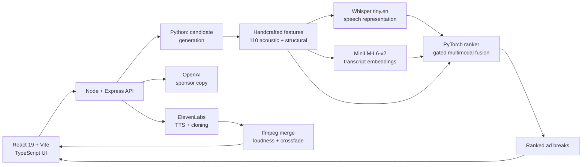

# Slotify

**Semantic and signal-aware ad insertion for audio.** Upload a podcast episode
or a song, and Slotify finds the best places for an ad to go, writes and voices
the sponsor read, and stitches it into the original audio with loudness matching
and crossfades.

UofTHacks 13 Winner — MLH Best Use of ElevenLabs.
[Video demo.](https://www.youtube.com/watch?v=S4m1lpipni0)

---

## What it does

An ad break in the wrong place is the difference between a listener tolerating a
sponsor read and skipping it. Slotify treats placement as a ranking problem
inside a single episode — of the couple hundred plausible cuts, which three are
best — and reads both the waveform and the transcript to answer it.

| Stage | What happens |
| --- | --- |
| **Analyze** | Candidate breakpoints generated from silence runs, pauses and RMS valleys across the whole episode, then ranked by a multimodal PyTorch model (see [Model status](#model-status)) or the frozen signal-based heuristic |
| **Preview** | Listen to the audio either side of a proposed cut before committing |
| **Generate** | Sponsor copy written for the product in the chosen tone and language, then voiced — optionally in a cloned voice |
| **Merge / export** | The read is spliced in — the episode pauses and resumes after it — with loudness matching and crossfaded joins, via `ffmpeg` |

Placement analysis runs credential-free. API keys only unlock the copywriting
and voice halves, and `GET /api/capabilities` tells the UI exactly which
features the running deployment can offer.

## Architecture



| Component | Stack | Role |
| --- | --- | --- |
| `frontend/` | React 19, TypeScript, Vite | Upload → analyze → select → generate → export |
| `backend/src/` | Node, Express, TypeScript (`tsx`, no build step) | Product API, ffmpeg muxing, ElevenLabs and OpenAI calls |
| `backend/ad_inserter/` | Python, librosa, ffmpeg | Audio analysis and the insertion/mixing pipeline |
| `ml/src/slotify_rank/` | Python, PyTorch, transformers, sentence-transformers | Features, model, training, evaluation, product inference |

Each candidate becomes one multimodal record: 110 handcrafted acoustic and
structural scalars, a frozen Whisper speech representation, and a frozen MiniLM
embedding of the transcript either side of the cut. A gated fusion model
combines them, giving an unavailable modality exactly zero weight rather than a
zero vector. Product inference reuses the training pipeline's feature code, and
before scoring the predictor checks the served features' column names and order,
and the normalizer's, against what the checkpoint was trained on.

## Model status

There are **no human labels yet**. The checkpoint the product serves,
`artifacts/training/gated-d8ed976101aa4c3b`, was trained on weak labels derived
from the heuristic baseline's own scores, with that score among its inputs — it
is a distillation of the heuristic, and it exists to prove the learned inference
path end to end. Its ranking is not independent evidence of placement quality,
and the evaluation refuses to report a headline for any model not trained on
human labels. The API says so in every learned
response (`provenance.trainingLabelSource` plus a warning), and the UI shows it.

Future weak-label runs drop the `heuristic_*` inputs their labels came from, and
the evaluation protocol (series-level bootstrap, a pre-registered 18 % threshold,
a frozen label snapshot) is enforced in code for when human labels exist. See
[`docs/model-training.md`](docs/model-training.md) and
[`docs/experiment-protocol.md`](docs/experiment-protocol.md).

## Tech stack

| Area | Used for |
| --- | --- |
| **PyTorch** | The ranking model, the trainer, checkpointing |
| **Hugging Face `transformers`** | `openai/whisper-tiny.en` encoder for speech representations |
| **`sentence-transformers`** | `all-MiniLM-L6-v2` transcript embeddings |
| **librosa** | Spectral and onset descriptors in the handcrafted block |
| **scikit-learn / NumPy / SciPy** | Feature assembly, metrics, bootstrap resampling |
| **TypeScript, React 19, Vite** | The product frontend |
| **Node, Express** | The product API |
| **OpenAI** | Sponsor copy generation |
| **ElevenLabs** | Text-to-speech and voice cloning |
| **ffmpeg / ffprobe** | Decoding, loudness matching, crossfades, muxing |

## Run it locally

Requires Node.js >= 22, Python 3.12, and `ffmpeg` + `ffprobe` on `PATH`.

```bash
git clone https://github.com/davidyang07/slotify
cd slotify

# 1) Node workspaces
npm run install:all

# 2) Python: the ML package (CPU-only) and the audio pipeline's requirements,
#    in one venv
cd ml && python -m venv .venv
.venv/Scripts/pip install -e ".[dev,label,features,sklearn]" -r ../backend/requirements.txt   # Windows
# .venv/bin/pip install -e ".[dev,label,features,sklearn]" -r ../backend/requirements.txt     # macOS / Linux
cd ..

# 3) Point the API at that interpreter
echo "PYTHON_BIN=$(pwd)/ml/.venv/Scripts/python.exe" >> backend/.env   # Windows (Git Bash)
# echo "PYTHON_BIN=$(pwd)/ml/.venv/bin/python" >> backend/.env       # macOS / Linux

# 4) Check your environment
npm run preflight

# 5) Run it
npm run demo
```

Then open <http://localhost:5173>, drop in an audio file, and click **Analyze**.
In development the UI calls the API through Vite's proxy, so it is same-origin
and needs no CORS setup.

Optional keys in `backend/.env`:

| Variable | Unlocks |
| --- | --- |
| `OPENAI_API_KEY` | Sponsor copy, tone and language, and slot narration |
| `ELEVENLABS_API_KEY` | Voice cloning and TTS |
| `HUGGINGFACE_TOKEN` | `pyannote` diarization for two-speaker mode |

### Before exposing the API

The API is open by default, for the local demo. Anything that can reach it can
spend your OpenAI and ElevenLabs credit, so before it listens anywhere but your
own machine:

| Variable | Effect |
| --- | --- |
| `SLOTIFY_API_TOKEN` | When set, every route except `GET /api/health` and `GET /api/capabilities` requires `Authorization: Bearer <token>` |
| `VITE_API_TOKEN` (frontend) | The token the UI sends. It is compiled into the bundle, so anyone who can load the page can read it: it keeps out clients that don't have the page, not users who do |
| `SLOTIFY_RATE_LIMIT_PAID_PER_MIN` | Per-IP limit on routes that call OpenAI or ElevenLabs (default 10; `0` disables) |
| `SLOTIFY_RATE_LIMIT_COMPUTE_PER_MIN` | Per-IP limit on analysis and merge (default 30) |
| `SLOTIFY_MAX_UPLOAD_MB` | Upload size cap (default 200) |
| `SLOTIFY_FFMPEG_TIMEOUT_MS`, `SLOTIFY_ANALYSER_TIMEOUT_MS`, `SLOTIFY_PIPELINE_TIMEOUT_MS` | Kill a stuck child process (defaults 2, 5 and 10 minutes) |

Rate limits key on the client IP Express sees; behind a reverse proxy, that is
the proxy's unless Express's `trust proxy` is configured.

### Ranker modes

```bash
RANKER_MODE=auto       # default: the learned model when a checkpoint is configured,
                       # falling back to the heuristic (with a warning) if it fails
RANKER_MODE=learned    # require the model; fail loudly if it is unusable
RANKER_MODE=heuristic  # the frozen signal-based scorer, ~7 s per episode
```

### Scoring a file from the CLI

```bash
cd ml
python -m slotify_rank.cli infer rank \
  --audio ../backend/audio_tests/ryan-test1.mp3 \
  --checkpoint ../artifacts/training/gated-d8ed976101aa4c3b/best_checkpoint.pt \
  --top 3
```

The output's `warnings` state that this checkpoint is a weak-label distillation
of the heuristic (see [Model status](#model-status)).

### Tests

```bash
npm run verify:all                      # frontend, backend, scripts and the ML suite
python -m pytest backend/tests/python   # the audio pipeline (needs backend/requirements.txt)
```

## Where things are

```text
.
├── backend/
│   ├── src/             # Express API: routes/, services/, lib/, middleware/
│   ├── ad_inserter/     # Python audio analysis + insertion pipeline
│   └── audio_tests/     # Sample audio for manual and CLI testing
├── frontend/src/        # React UI
├── ml/src/slotify_rank/ # Features, embeddings, models, training, inference, evaluation
├── config/              # The frozen signal-based scorer, shared by TS and Python
├── docs/                # Pipeline, dataset, training and demo documentation
└── scripts/             # preflight, demo, verify
```

## Documentation

| Document | What it covers |
| --- | --- |
| [`docs/feature-pipeline.md`](docs/feature-pipeline.md) | The multimodal feature pipeline |
| [`docs/model-training.md`](docs/model-training.md) | The training system |
| [`docs/model-inference.md`](docs/model-inference.md) | How a request becomes a learned ranking |
| [`docs/ad-inserter.md`](docs/ad-inserter.md) | The insertion pipeline, two-speaker modes and voice cloning |
| [`docs/demo-runbook.md`](docs/demo-runbook.md) | The 2-3 minute demo walkthrough |
| [`DESIGN.md`](DESIGN.md) | The UI design system: tokens, components and rules (read by AI coding agents too) |
| [`ml/README.md`](ml/README.md) | Every ML command |

## License

MIT. See [`LICENSE`](LICENSE).
